<div align="center">

# CompCounter

**Torneos de deportes de contacto de punta a punta: llaves, horarios, puntaje en vivo desde el celular y pantallas para el público.**

Kickboxing · Jiu-jitsu · Grappling · Point Fighting


[](https://github.com/leven2000/CompCounter/actions/workflows/ci.yml)

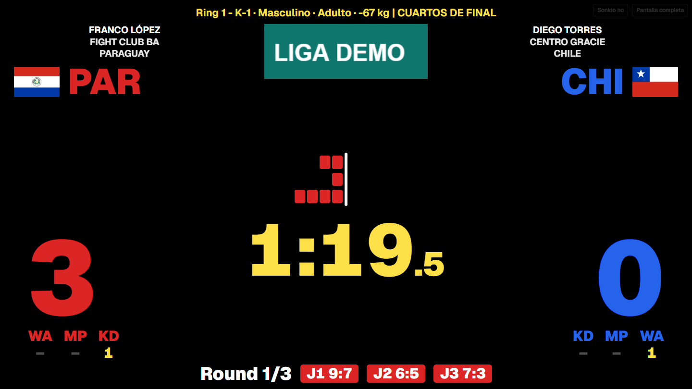

</div>

## Qué es

CompCounter es una aplicación web para organizar y transmitir en vivo torneos de deportes de contacto. El organizador arma categorías, competidores, llaves y horarios; la mesa maneja el reloj y las sanciones; los jueces de kickboxing puntúan desde su celular con un código, y el público sigue todo en los televisores del lugar.

No hay nada que instalar: todo funciona en el navegador, incluidos el pad de los jueces y las pantallas de TV.

> **In English:** CompCounter is a web app for running combat-sports tournaments end to end: brackets, scheduling, real-time judge scoring from phones, and TV scoreboards. Built with Next.js 16, React 19, Prisma and PostgreSQL, with Server-Sent Events for the live layer.

## Capturas

<table>
  <tr>
    <td width="50%">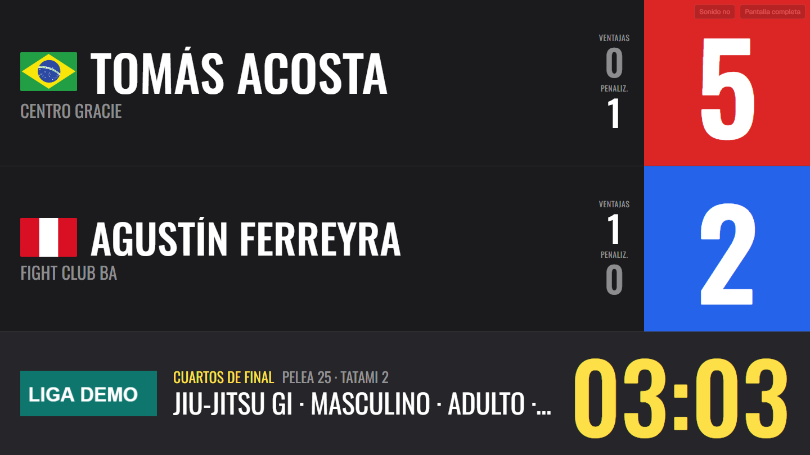<br><sub><b>TV de jiu-jitsu.</b> Puntos, ventajas, penalizaciones y reloj.</sub></td>
    <td width="50%">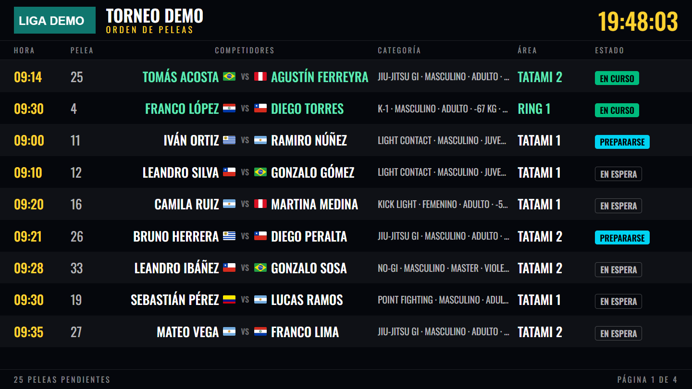<br><sub><b>Cartelera.</b> Hora, área y estado de cada pelea, como en un aeropuerto.</sub></td>
  </tr>
  <tr>
    <td>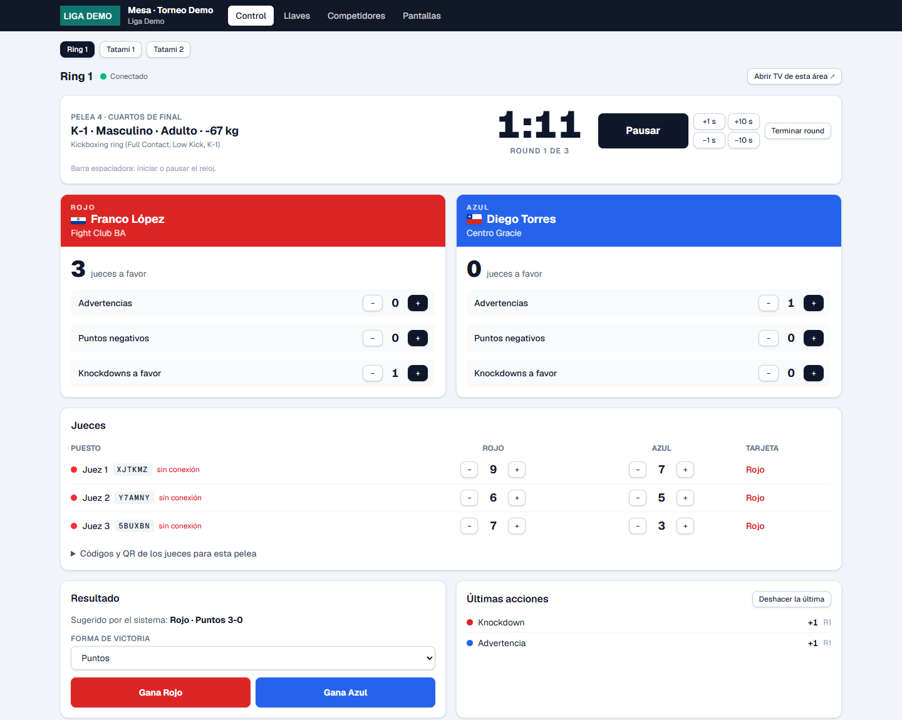<br><sub><b>Mesa de control.</b> Reloj, sanciones, tarjetas de los jueces y resultado.</sub></td>
    <td>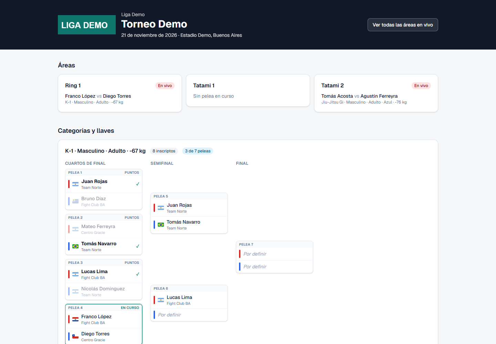<br><sub><b>Página pública.</b> Áreas en vivo y llaves que se actualizan solas.</sub></td>
  </tr>
  <tr>
    <td>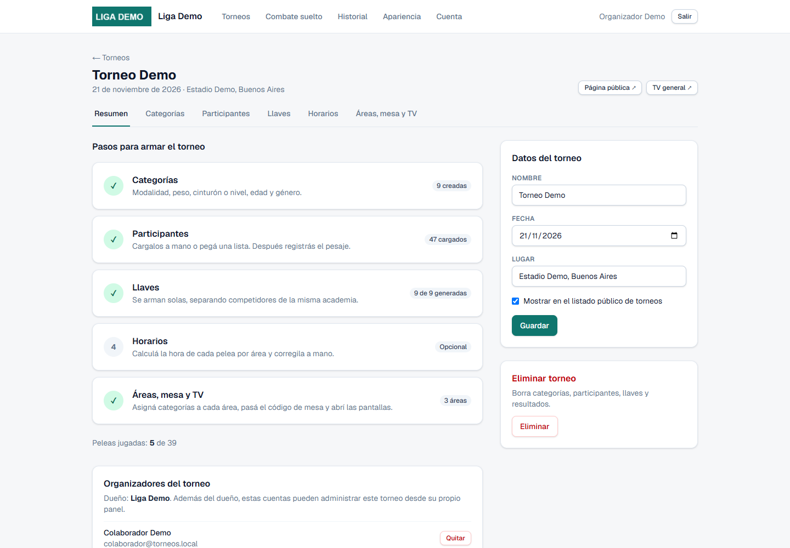<br><sub><b>Panel del organizador.</b> Los pasos para armar un torneo y quién lo administra.</sub></td>
    <td>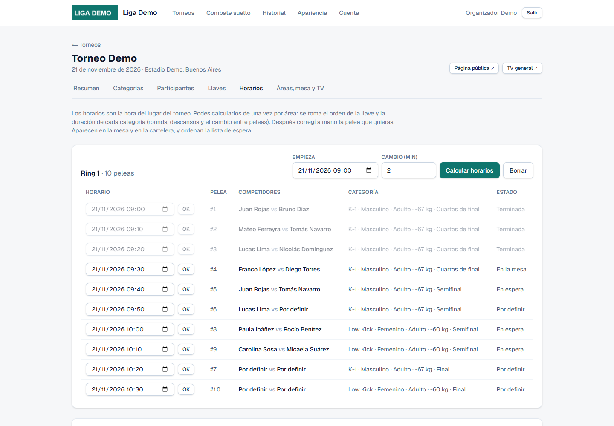<br><sub><b>Horarios.</b> Se calculan por área y se corrigen a mano.</sub></td>
  </tr>
  <tr>
    <td>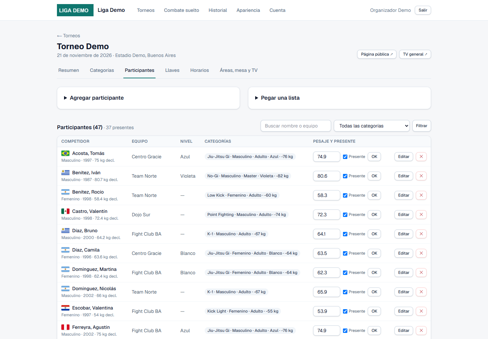<br><sub><b>Participantes.</b> Alta manual o pegando una lista, pesaje y presentes.</sub></td>
    <td>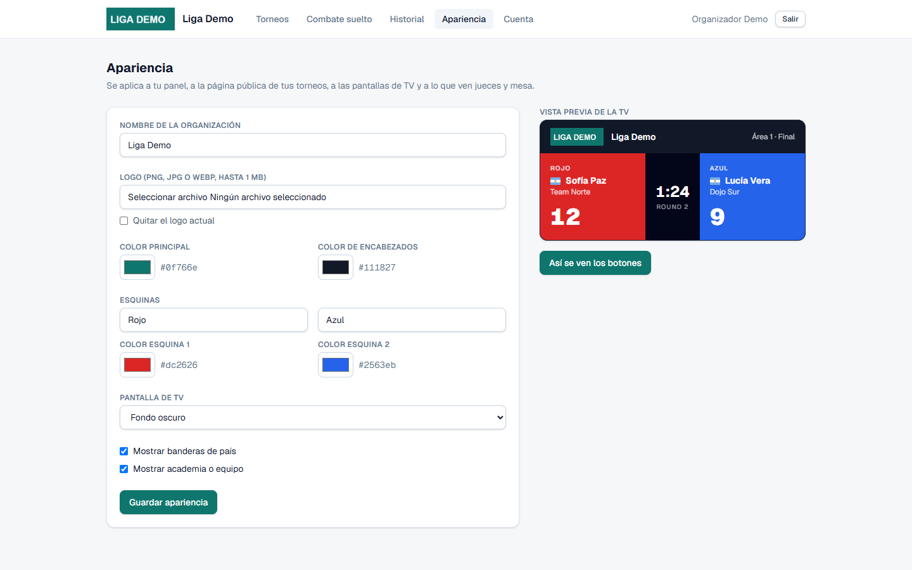<br><sub><b>Apariencia.</b> Logo, colores y nombres de esquinas por organizador.</sub></td>
  </tr>
  <tr>
    <td>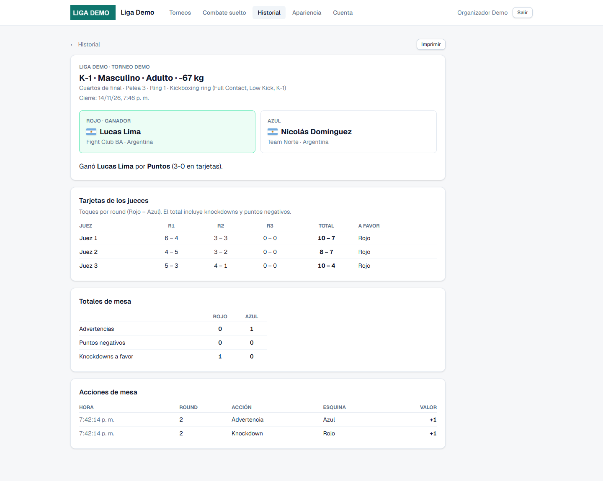<br><sub><b>Acta.</b> Resultado, tarjetas por round y acciones de mesa, lista para imprimir.</sub></td>
    <td align="center">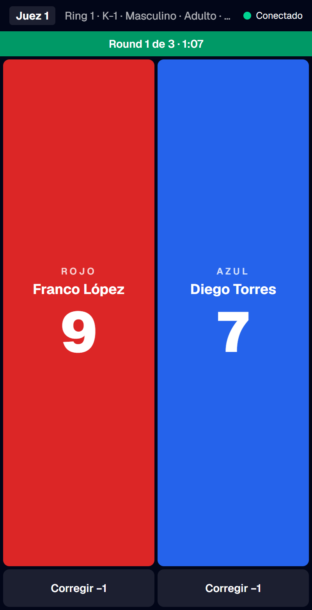<br><sub><b>Pad del juez.</b> En el celular, con un código por pelea.</sub></td>
  </tr>
</table>

## Funciones

**Torneos**
- Categorías por modalidad, género, edad, cinturón o nivel y peso, con un generador que las arma en bloque.
- Competidores con academia, país, foto, pesaje y aviso cuando alguien queda fuera de peso.
- Carga de inscriptos desde un Excel o CSV: crea competidores, categorías y escuelas, muestra qué va a cargar antes de guardar y no duplica al volver a subir.
- Llaves de eliminación simple y de todos contra todos, que separan a los compañeros de academia y respetan cabezas de serie.
- El formato se elige en la pantalla de Llaves, para todo el torneo o llave por llave; también se puede armar una llave a mano y fusionar dos categorías de la misma disciplina.
- Horarios calculados por área según la duración de cada categoría.
- Combates sueltos sin torneo ni llave, para exhibiciones o peleas estelares.
- Torneo demo completo con un botón, para mostrar el sistema.

**En vivo**
- Mesa de control con reloj por rounds, descansos automáticos, sanciones, deshacer y reapertura de resultados.
- Jueces de kickboxing que puntúan desde el celular; cada pelea tiene sus propios códigos y QR.
- Tableros de TV distintos para kickboxing y para jiu-jitsu, una vista general de áreas y una cartelera con el orden de peleas.
- Si un juez pierde conexión, sus toques quedan en cola y se reenvían sin duplicarse.

**Administración**
- Un administrador de la plataforma da de alta organizadores y puede entrar al panel de cualquiera.
- Cada organizador personaliza logo, colores y nombres de esquinas, y puede compartir un torneo con otras cuentas.
- Historial de torneos y peleas con acta imprimible por pelea.

## Quién usa qué

| Rol | Entra por | Qué hace |
|---|---|---|
| Administrador de la plataforma | `/login` → `/admin` | Da de alta organizadores, ve el historial de todos y entra al panel de cualquiera |
| Organizador | `/login` → `/panel` | Crea torneos, categorías, participantes, llaves, horarios y áreas; personaliza la marca; comparte torneos |
| Mesa del torneo | `/mesa/CODIGO` | Un código por torneo. Llama peleas, maneja el reloj, carga puntos y sanciones, declara el ganador |
| Juez | `/juez/CODIGO` o QR | Solo suma puntos, únicamente en kickboxing, con un código que vale para una pelea |
| Público | `/t/slug` | Áreas en vivo, llaves y podios |
| Televisores | `/tv/...` y `/cartelera/slug` | Tablero de la pelea, vista general y cartelera |

## Cómo funciona el vivo

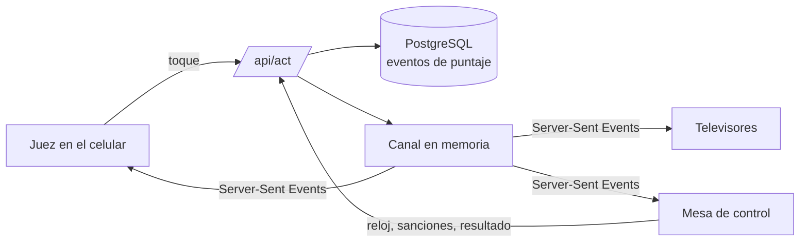

- Cada toque de juez y cada acción de mesa se guarda como un evento. El puntaje se calcula siempre a partir de esos eventos, así que deshacer y auditar es directo.
- El reloj lo lleva el servidor: cuando vence un round pasa solo al descanso y después al round siguiente, aunque la mesa cierre la pestaña.
- Mesa, jueces y TV reciben el estado por Server-Sent Events y se reconectan solos.
- Las reglas de cada modalidad (rounds, sanciones automáticas, formas de victoria) están declaradas como datos en [`src/lib/rules.ts`](src/lib/rules.ts).

## Stack

- **Next.js 16** (App Router, Server Components y Server Actions) con **React 19** y **TypeScript**.
- **PostgreSQL** con **Prisma** y migraciones versionadas.
- **Tailwind CSS 4** para la interfaz.
- **Server-Sent Events** para el tiempo real, sin servicios externos.
- Sesiones con JWT firmado en cookie y contraseñas con bcrypt.

## Desarrollo local

Requiere Node 24. No hace falta instalar Postgres: el proyecto trae uno embebido para desarrollo.

```bash
npm install
```

```bash
npm run db
```

Dejá esa terminal abierta. En otra:

```bash
npx prisma migrate dev
```

```bash
npm run db:bootstrap
```

```bash
npm run dev
```

Copiá `.env.example` a `.env` y completá los valores antes del primer arranque. La cuenta de administrador se crea con `ADMIN_EMAIL` y `ADMIN_PASSWORD` la primera vez que corre `db:bootstrap` (o `npm run start`).

## Variables de entorno

| Variable | Para qué |
|---|---|
| `DATABASE_URL` | Conexión a PostgreSQL |
| `AUTH_SECRET` | Firma de sesiones, 16 caracteres o más, aleatoria |
| `ADMIN_EMAIL` / `ADMIN_PASSWORD` | Cuenta de administrador que se crea si no existe ninguna |
| `NEXT_PUBLIC_APP_NAME` | Nombre visible de la plataforma (se fija al compilar) |

## Despliegue en Railway

1. Creá un proyecto en Railway desde este repositorio de GitHub.
2. Agregá un servicio PostgreSQL al mismo proyecto.
3. En el servicio de la app, pestaña Variables, cargá `DATABASE_URL` como referencia a la del Postgres (`${{Postgres.DATABASE_URL}}`), `AUTH_SECRET`, `ADMIN_EMAIL`, `ADMIN_PASSWORD` y `NEXT_PUBLIC_APP_NAME`. Railway precarga los valores de `.env.example`: reemplazalos todos. La app no arranca con el `AUTH_SECRET` ni con el administrador de ejemplo.
4. Railway detecta los comandos solo: compila con `npm run build` y arranca con `npm run start`, que aplica las migraciones, crea el administrador si falta y levanta el servidor en el puerto asignado.
5. En Settings → Networking, generá un dominio público.

Dejá el servicio en **una sola réplica**: el canal en vivo entre jueces, mesa y TV vive en la memoria del proceso. Para escalar hay que pasarlo a Redis o a `LISTEN/NOTIFY` de Postgres ([`src/lib/bus.ts`](src/lib/bus.ts)).

## Integración continua

Cada push a `main` y cada pull request corren en GitHub Actions ([`.github/workflows/ci.yml`](.github/workflows/ci.yml)):

1. Aplica todas las migraciones desde cero sobre un Postgres efímero.
2. Controla que el esquema no haya cambiado sin su migración.
3. Corre lint, las pruebas de puntaje y sanciones, las de la carga desde Excel, las de los controles de jueces, las de las copias de seguridad, el chequeo de tipos y el build.

Railway despliega solo cada commit que llega a `main`. Con la opción **Wait for CI** del servicio (Settings → Source), espera a que el CI termine y saltea el despliegue si falla.

Las pruebas también corren en local:

```bash
npm run probar:puntaje
```

```bash
npm run probar:importacion
```

## Carga desde Excel

En Participantes → Subir planilla se carga un Excel (.xlsx) o un CSV con una fila por competidor. La planilla modelo se descarga desde esa misma pantalla.

- Solo el nombre es obligatorio. Con disciplina y categoría, el competidor queda inscripto y la categoría se crea si no existe.
- Las columnas se reconocen por su título, en cualquier orden, y se pueden corregir a mano antes de cargar.
- Cada disciplina de la planilla se asocia a una modalidad del sistema. Las que no se reconocen hay que elegirlas.
- Quien compite en dos categorías va en dos filas. La misma persona de la misma escuela no se duplica, tampoco al subir otra planilla.
- El archivo se lee en el navegador. Los Excel de formato viejo (.xls) hay que guardarlos como .xlsx.

La planilla modelo se regenera con `npm run plantilla`.

## Versión de escritorio (Windows, sin internet)

La carpeta [`desktop/`](desktop) empaqueta la misma aplicación como un programa de Windows que no necesita internet ni cuenta: trae su propia base de datos y abre directo en el panel.

- **Base propia:** un PostgreSQL embebido que solo escucha en la computadora. Los datos quedan en `%APPDATA%\CompCounter` (menú Archivo → Abrir la carpeta de datos).
- **Ventanas:** la mesa, cada TV, la cartelera y la página pública se abren en su propia ventana. Si hay un televisor o proyector conectado, las pantallas se abren ahí en pantalla completa. F11 entra y sale de pantalla completa.
- **Copias de seguridad:** se guardan solas cada 5 minutos si hubo cambios, al cerrar, antes de actualizar el programa y antes de restaurar. Van a `DocumentosCompCounterCopias de seguridad` o a la carpeta que se elija (conviene un pendrive u otro disco). Desde la barra de abajo del panel se hace una a mano, se cambia la carpeta y se restaura. Restaurar reemplaza todo y reinicia el programa; también sirve para pasar los datos a otra computadora.
- **Jueces con controles:** en lugar del celular, cada juez usa un control inalámbrico tipo Xbox. En la mesa, pestaña Controles, se asigna un control a cada juez y se eligen los botones para sumar y restar a cada esquina. El control vibra cuando el punto quedó registrado.

Límites: Windows reconoce hasta 4 controles de este tipo a la vez; la asignación se hace de nuevo cada vez que se abre el programa; el instalador no está firmado, así que Windows muestra una advertencia al ejecutarlo; no hay actualización automática.

Para generar el instalador, con la base de desarrollo levantada (`npm run db`):

```bash
npm --prefix desktop install
```

```bash
npm --prefix desktop run dist
```

Queda en `desktop/dist/`. Si npm no corre los scripts de instalación, el binario de Electron se baja con `node desktop/node_modules/electron/install.js`. La lógica de los controles se prueba con `npm run probar:controles` y la de las copias con `npm run probar:copias`. La copia y la restauración completas, contra una base real, se prueban con `npm --prefix desktop run probar:copias`.

## Modalidades incluidas

- Kickboxing ring (Full Contact, Low Kick, K-1): tres jueces que acumulan un punto por toque; el punto negativo resta 3 a cada juez y el knockdown suma 1.
- Light Contact / Kick Light: igual que el anterior, sin knockdowns.
- Point Fighting: la mesa carga 1, 2 o 3 puntos.
- Jiu-Jitsu por puntos: 2, 3 y 4 puntos, ventajas y penalizaciones.
- Grappling solo finalización.
- Genérico por puntos.

Las sanciones se ajustan por categoría o por combate suelto, y la mesa puede cambiarlas para una pelea puntual:

- **Sanciones automáticas:** se pueden apagar.
- **Descalificación directa:** a cuántas advertencias o penalizaciones corresponde descalificar (0 = nunca).
- **Punto negativo:** resta al sancionado o suma al rival, con valor configurable. Con jueces se aplica en cada tarjeta. También se puede habilitar en jiu-jitsu.

Conviene hacerlas revisar por un árbitro antes de usarlas en un torneo oficial.

## Límites conocidos

- Necesita internet en el lugar del torneo. No hay modo sin conexión.
- No hay doble eliminación ni repechaje.
- No hay inscripción pública ni cobros: los participantes los carga el organizador.
- No hay video review ni overlay para streaming.
- Fotos y logos se guardan en la base de datos, con un máximo de 1 MB cada uno.
